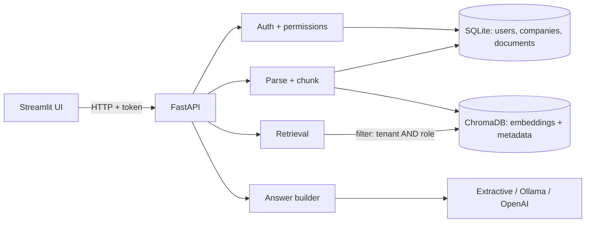

# bhalamukunthan-companybrain

# 🧠 CompanyBrain — Private Enterprise Knowledge Assistant

A multi-tenant **RAG** (Retrieval-Augmented Generation) app. Employees ask questions in plain English and get answers grounded in their company's approved documents, with source citations. Tenant isolation and role-based document permissions are enforced **on the server**, inside the vector search itself.

> **Status:** learning/portfolio project. See [Security limitations](#security-limitations) and [Moving to production](#moving-to-production).

## Features
- Register a company (tenant); admin creates users with roles `admin`, `hr`, `engineering`, `employee`
- bcrypt password hashing, signed JWT login tokens, role re-checked from the database on every request
- Upload PDF/TXT (size, type, empty, corrupted and password-protected files rejected safely)
- Chunking with metadata (title, tenant, department, permitted roles, page, uploader, date)
- Local embeddings (Sentence Transformers) + ChromaDB with **tenant + role metadata filter during search**
- Defence in depth: results are re-checked against the database before being used
- Answers with citations (filename + page); abstains with *"I could not find this information in the approved documents."*
- Pluggable answer generator: `extractive` (default, no LLM), `ollama` (local), `openai` (external, opt-in only)
- Streamlit UI: login/register, upload, library, chat, admin
- pytest suite (parsing, auth, permissions, tenant isolation) and a retrieval evaluation script

## Architecture

**Upload:** permission check → parse → chunk → embed → index with metadata → save record.
**Question:** identify user → embed question → Chroma search filtered by `tenant_id` and `allow_<role>` → distance threshold → DB re-check → generate answer → cite sources (or abstain).

## Folder guide
| Path | Purpose |
|---|---|
| `app/main.py` | Creates the FastAPI app and registers routers |
| `app/config.py` | Reads settings from environment / `.env` |
| `app/database.py` | SQLite schema and connections |
| `app/auth/` | Password hashing, tokens, login/register, `get_current_user` |
| `app/permissions/` | **All** permission rules in one place |
| `app/admin.py` | Admin-only user management |
| `app/documents/` | Parser, chunker, ingestion service, upload/list/download/delete API |
| `app/retrieval/` | Embeddings and the ChromaDB wrapper (filtered search) |
| `app/chat/` | Question endpoint and LLM providers |
| `frontend/app.py` | Streamlit UI |
| `tests/` | pytest tests |
| `eval/` | Retrieval-quality evaluation |
| `sample_data/` | Fictional policies + manifest of permissions |
| `scripts/seed_demo.py` | Loads a demo company into a running backend |

## Setup (Windows PowerShell)
Prerequisites: Python 3.12, Git, ~5 GB free disk, internet for the first install.
```powershell
cd companybrain
python -m venv .venv
.\.venv\Scripts\Activate.ps1          # if blocked: Set-ExecutionPolicy -Scope CurrentUser RemoteSigned
python -m pip install --upgrade pip
pip install -r requirements.txt       # large download (PyTorch); takes a while
copy .env.example .env                # then edit SECRET_KEY
```
Generate a secret key: `python -c "import secrets; print(secrets.token_urlsafe(48))"`

## Run
Terminal 1 (backend; first question downloads the embedding model once):
```powershell
.\.venv\Scripts\Activate.ps1
uvicorn app.main:app --reload
```
Open http://127.0.0.1:8000/docs for the interactive API documentation.

Terminal 2 (frontend):
```powershell
.\.venv\Scripts\Activate.ps1
streamlit run frontend/app.py
```
Optional demo data (backend must be running, third terminal):
```powershell
python scripts/seed_demo.py
```
Then log in as company `Acme`, user `emp_user` / `hr_user` / `eng_user` / `admin`, password `DemoPass123` and compare what each role can see. Company `Globex` proves tenant isolation.

## Tests and evaluation
```powershell
pytest -v                      # uses fake embeddings: fast, offline
python -m eval.eval_retrieval  # uses the real model from your .env; reports hit@k, grounding, permission leaks
```
Note: the pytest suite uses a word-hash "fake" embedder so it runs fast. It verifies **permissions and plumbing**, not semantic quality. Semantic quality is what `eval.eval_retrieval` measures with real embeddings. Tune `MAX_DISTANCE` using that script.

## Choosing the answer generator
- `LLM_PROVIDER=extractive` (default): shows the best matching passages verbatim. No AI model, no data leaves your laptop.
- `LLM_PROVIDER=ollama`: install [Ollama](https://ollama.com), run `ollama pull llama3.2`. Fully local.
- `LLM_PROVIDER=openai`: **sends retrieved passages to an external service.** Requires `ALLOW_EXTERNAL_LLM=true` and `OPENAI_API_KEY`. Only use with data you are allowed to share.

## Security limitations
- SQLite + local Chroma files are for learning/demo, not production.
- No login rate limiting, account lockout, password reset, MFA, or email verification.
- Tokens are bearer JWTs held in Streamlit session state; no refresh or revocation list (a deleted user is blocked because the DB is checked each request).
- HTTP only (no TLS) on localhost. Uploaded files are stored unencrypted on disk.
- No malware scanning of uploads. Prompt injection inside documents is mitigated (passages are labelled as data) but not eliminated when using an LLM.
- Scanned/image-only PDFs are not supported (no OCR).
- Distance threshold for "not found" is heuristic and must be tuned.

## Moving to production
PostgreSQL (with row-level security or per-tenant schemas), HTTPS behind a reverse proxy, secrets manager, rate limiting, audit logging, backups, refresh tokens/SSO, encrypted file storage (e.g. S3 + KMS), a managed or server-mode vector store, background ingestion workers, monitoring, and a formal security review.

## License
MIT — see `LICENSE`. MIT is short, permissive and widely recognised in portfolios.

